# Лабораторная работа №6. Система контроля версий

Группа 4514, Черняк О.С.

## Цель работы

Изучение базовых возможностей системы управления версиями, работа с Git и GitHub…

## Ход работы
### Пункт 1
аккаунт на сайте GitHub уже был
### Пункт 2-4
2. Создана копия (Fork) репозитория `https://github.com/Kurtyanik/LR6`.
3. Установлен Git (git-scm.com).
4. Настроены `user.name` и `user.email`.
   
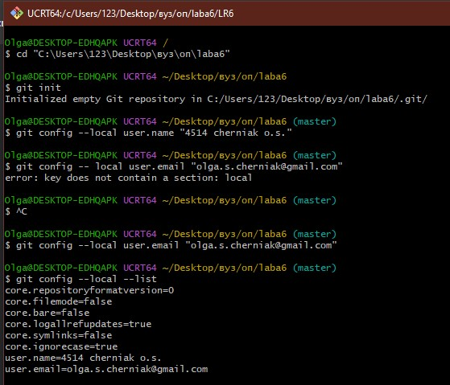
### Пункт 5
Клонировать свой личный удалённый репозиторий на компьютер. 

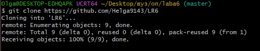
### Пункт 6
Добавить файл через интерфейс GitHub. Подтянуть изменения в локальный репозиторий. 

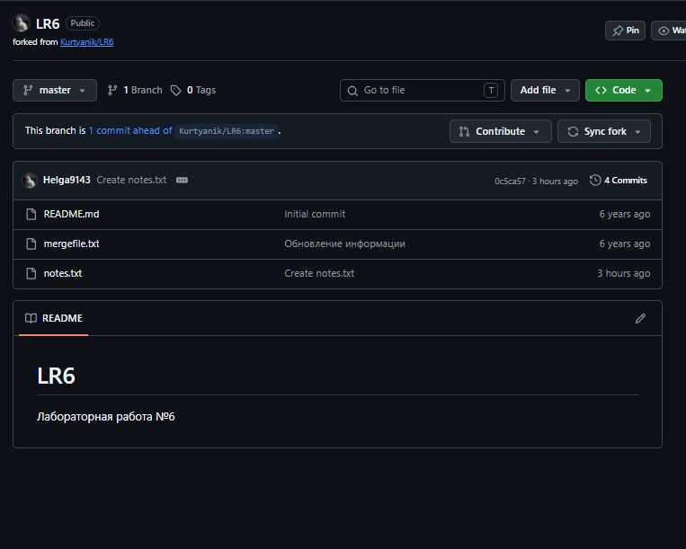
### Пункт 7-8
Получить историю операций для каждой из веток.
Просмотреть последние изменения. 

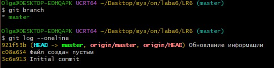
### Пункт 9
Выполнить слияние в ветку master, разрешив конфликт (можно использовать специальные редакторы или графический интерфейс git). 

%20.jpg)

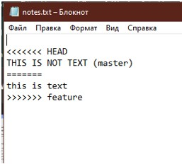
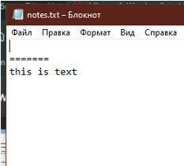
### Пункт 10
Удалить побочную ветку после успешного слияния. 

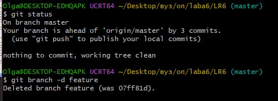
### Пункт 11
Сделать изменения и зафиксировать их, оставляя комментарии, несколько раз. 

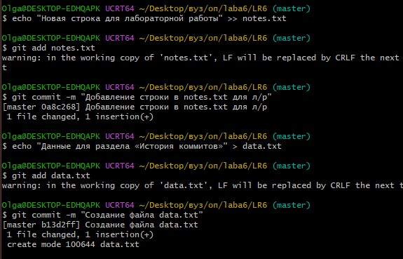
.jpg)

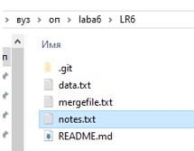
### Пункт 12
Сделать откат коммита. 

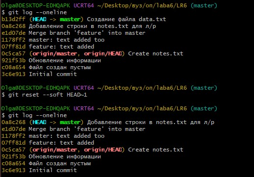
### Пункт 13-15
13. Создать ветку для отчёта.
14. Начать оформлять отчёт в файле README.md, используя markdown синтаксис В отчёте должен быть снимки экрана консоли и сторонних программ. Файлы снимков экрана разместить в отдельной папке. При написании отчёта периодически делать коммиты, не забывать комментировать.
15. Получить историю операций в форматированном виде (сокращённый хэш + дата + имя автора + комментарий). Добавить её в отчёт и сделать финальную фиксацию изменений.
    
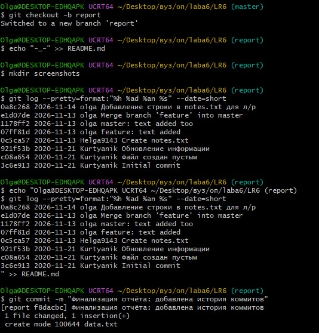
```bash
Olga@DESKTOP-EDHQAPK UCRT64 ~/Desktop/вуз/оп/laba6/LR6 (report)
$ git log --pretty=format:%h %ad %an %s --date=short
0a8c268 2026-11-14 olga Добавление строки в notes.txt для л/р
e1d07de 2026-11-13 olga Merge branch 'feature' into master
1178ff2 2026-11-13 olga master: text added too
07ff81d 2026-11-13 olga feature: text added
0c5ca57 2026-11-13 Helga9143 Create notes.txt
921f53b 2020-11-21 Kurtyanik Обновление информации
c08a654 2020-11-21 Kurtyanik Файл создан пустым
3c6e913 2020-11-21 Kurtyanik Initial commit


